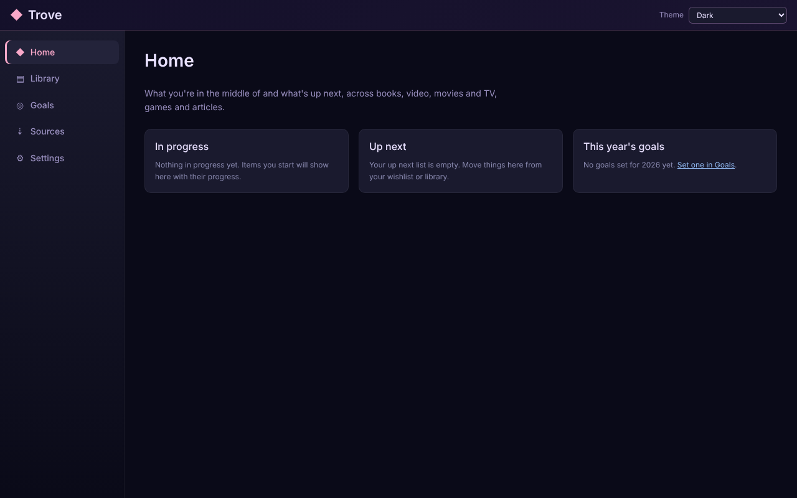

# Trove

An ingestion hub for media I want to consume or track: what to read, watch, play and listen to, what I own, what I'm in
the middle of, what I've finished, and how the year's goals are going. Private, on my tailnet, with no social layer.

Part of the [HopeLab](https://github.com/QuantumHope/HopeLab) bench.

## Status

A shell: the layout, navigation (Home, Library, Goals, Sources, Settings), placeholder screens and the 24 shared
HopeLab themes. Nothing is stored yet.

## Run it

```bash
dotnet run --project src/Trove.Web   # http://localhost:5317
dotnet test Trove.slnx
```

Needs the .NET 10 SDK. See `CLAUDE.md` for the layout and the decisions behind it.


